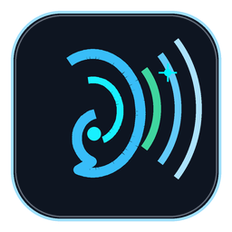
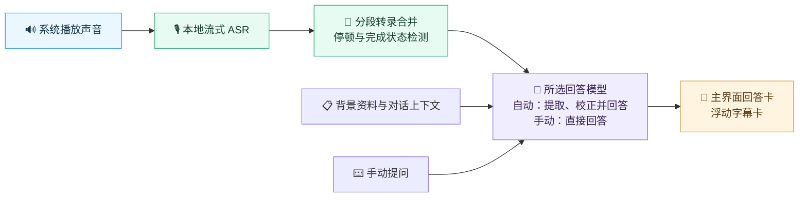

<p align="center">
  
</p>

<h1 align="center">附耳 Earcue</h1>

<p align="center">
  听见问题，整理思路，让回答及时出现。<br />
  Windows 桌面语音助手 · 本地流式识别 · 问题提取校正 · 实时回答字幕卡
</p>

<p align="center">
  <a href="https://github.com/AK993/Earcue/releases/latest"></a>
  <a href="https://github.com/AK993/Earcue/actions/workflows/ci.yml"></a>
  
  
  
</p>

<p align="center">
  <a href="https://github.com/AK993/Earcue/releases/latest">📦 下载免安装版</a> ·
  <a href="#quick-start">🚀 快速开始</a> ·
  <a href="#faq">💬 常见问题</a> ·
  <a href="https://github.com/AK993/Earcue/issues">🐛 反馈问题</a>
</p>

## 🧭 工作流程



语音识别在本机 CPU 上运行；问题提取、校正和回答由你配置的 OpenAI 兼容模型服务完成。识别原文与整理后的问题都可查看，回答逐步显示在主界面和字幕卡中。

**阅读导航：** [功能](#features) · [下载与运行](#quick-start) · [ASR 模型](#asr-models) · [模型接口](#llm-settings) · [字幕卡](#overlay) · [隐私与数据](#privacy) · [常见问题](#faq) · [开发与打包](#development)

<a id="features"></a>

## ✨ 功能一览

| 功能 | 说明 |
| --- | --- |
| 🎙️ 本地语音识别 | 内置三套流式 ASR，支持中文和中英混合语音，在设置中切换 |
| 📝 自动整理问题 | 合并被 ASR 拆开的发言，提取核心问题，整理重复口语、标点和有依据的识别错误 |
| 🔎 原文与校正对照 | 展开查看识别原文，核对整理结果；可编辑问题后重新回答 |
| 🧠 流式模型回答 | 连接 OpenAI 兼容接口，回答随生成进度持续显示 |
| 💬 浮动字幕卡 | 支持拖动、缩放、点击穿透、多显示器位置调整及预览 |
| 🎨 独立透明度 | 字幕卡背景和文字分别调整不透明度，实时预览并保存 |
| 🔁 自动重试 | 失败后固定等待 2 秒继续请求，直到成功或主动停止 |
| ⌨️ 手动提问 | 直接输入问题、重新回答、选中文字或一键复制回答 |
| 📋 背景资料 | 选择角色，粘贴或导入简历，让回答结合已有资料 |
| 📚 简历专业词 | 根据已保存的简历自动提取专业词，去重合并到现有词表，支持编辑与取消 |
| 🛠️ 运行恢复 | 支持音频异常重连、识别失败提示、配置损坏备份及系统托盘 |

<a id="quick-start"></a>

## 🚀 下载与运行

### 运行环境

| 项目 | 要求 |
| --- | --- |
| 操作系统 | Windows 10 2004 或更新版本 / Windows 11 |
| 系统架构 | x64（64 位） |
| .NET 运行时 | 官方免安装包已包含 .NET 8 运行时 |
| 语音识别 | 本地 CPU 推理；完整版附带三套模型，Lite 按需下载 |
| 网络 | 调用回答模型时需要能访问所配置的服务 |
| 模型账号 | 准备自己的 API Key，调用费用按所选服务商规则计算 |

### 1. 下载并解压

前往 **[Releases 下载页面](https://github.com/AK993/Earcue/releases/latest)**，v0.1.11 提供两种分发方式：

| 分发方式 | 文件 | 模型准备 |
| --- | --- | --- |
| 📦 完整版 | `Earcue-v0.1.11-win-x64.zip` | 内含三套模型，保留默认使用的 INT8 权重 |
| 🪶 Lite 轻量版 | `Earcue-v0.1.11-win-x64-Lite.zip` | 包含 .NET 运行时，首次使用时在应用中按需下载模型 |

v0.1.11 下载大小：**Lite 约 77.6 MiB，三模型完整版约 474.6 MiB**。完整版通过移除重复 FP32 权重缩小体积，默认使用的 INT8 推理权重保留。

- 🧩 两种包均包含应用程序、.NET 运行时和空白用户配置。
- ▶️ 完整解压到可写目录后，双击 `Earcue.App.exe` 启动。

请保留解压后的目录结构与依赖文件；完整版还需要随包的 `models` 文件夹。

<details>
<summary>🔐 校验下载文件完整性</summary>

同时下载 Release 中的 `.sha256` 文件，在 ZIP 所在目录打开 PowerShell：

```powershell
Get-FileHash .\Earcue-v0.1.11-win-x64-Lite.zip -Algorithm SHA256
Get-Content .\Earcue-v0.1.11-win-x64-Lite.zip.sha256
```

对比两处 SHA256，字符应完全一致，大小写不影响结果。

</details>

### 2. 配置回答模型

打开左侧 **「模型与设置」→「回答模型」**，选择服务商或填写兼容接口地址，输入自己的 API Key，获取并选择模型，再点击 **「测试连接」**。确认测试成功后保存设置。

### 3. 准备背景资料

在 **「面试资料」** 中选择角色，粘贴背景资料或导入 `.txt`、`.md`、`.markdown`、`.docx` 文件。程序会将相关资料加入回答上下文。

### 4. 开始聆听

点击 **「开始聆听」**，程序监听默认输出设备播放的声音。当说话停顿、识别结果完成且满足自动应答条件时，开始整理问题并生成回答。

v0.1.11 起，可以在 **「模型与设置」→「自动应答」** 勾选 **「记住我的回答（使用默认麦克风）」**，保存后重新开始聆听。该功能默认关闭。开启后，附耳在本机分别转录默认麦克风和系统播放的声音。我方发言标为「我」，只进入近期上下文。对方追问时，附耳将实际问答文字交给所配置的回答模型。

当前版本采集系统声音；需要补充自己的发言时，可使用手动提问。关闭主窗口后程序会隐藏到托盘，右键托盘图标选择 **「彻底退出」** 才会结束运行。

<a id="asr-models"></a>

## 🎙️ 三套本地 ASR 模型

| 模型 | 语言 | 特点与选用思路 |
| --- | --- | --- |
| 中文流式 Zipformer 14M | 中文 | 模型较小，适合以中文为主的内容；可先用它检查本机识别速度 |
| 中英双语流式 Zipformer | 中文、英文 | 适合中英混说和英文术语较多的内容，模型比中文 14M 版大 |
| 中英双语流式 Paraformer INT8 | 中文、英文 | 使用 INT8 量化权重，可与 Zipformer 对比相同音频的识别效果 |

切换步骤：**「模型与设置」→「语音识别」→选择模型→「保存并应用」**。如果正在采集，先停止聆听，再重新开始即可使用新模型，无需退出程序。选择会保存到本机配置。

三套模型均在本地 CPU 上运行。实际识别速度和准确度受处理器、音质、口音与专有词影响，可使用同一段音频进行比较。ASR 负责把声音转换为文字；后续的问题提取和校正使用当前配置的回答模型。

模型来源、固定下载地址与 SHA256 见 [ASR 模型清单](src/Earcue.Speech/Asr/asr-models.json)。

### 🪶 按需下载模型

Lite 首次开始聆听时，如果模型尚未安装，会打开语音识别设置。选择模型并点击 **「下载所选模型」**，即可查看进度和大小，支持随时取消。安装前会校验 SHA256；失败或取消时清理未完成内容，保留已有模型。

默认缓存为 `%LOCALAPPDATA%\Earcue\models`，同一用户可在后续版本中复用。下载需要能访问 GitHub / Hugging Face。保存设置后点击「开始聆听」即可使用。

### 📚 专业词与人名

在 **「模型与设置」→「语音识别」→「专业词与人名」** 中，每行填写一个词，例如：

```text
语音识别
灰度发布
Kubernetes
SQL Server
```

词表最多 200 个词，每词最多 64 字，重复词自动合并。保存后停止并重新开始聆听，新的解码词表生效。

**根据简历自动填充：** 先在「面试资料」中填写或导入并保存简历，再点击词表上方的「根据简历自动填充」。程序使用当前回答模型提取最多 80 个专业词，校验词语在简历中实际出现后，去重合并到现有词表。手工词保留，总量上限为 200 个；可检查、编辑后保存。取消或提取失败时原词表保持不变。

此操作会将已保存的简历文本发送至所选模型服务，不携带会议对话。简历最多 30,000 字符，提取前请配置可用的回答模型。

| 模型 | 词表的作用 |
| --- | --- |
| 中文 Zipformer 14M | 使用束搜索增强可编码的中文词；其余词供问题校正参考 |
| 双语 Zipformer | 使用束搜索增强可编码的中文、英文词组；其余词供问题校正参考 |
| Paraformer INT8 | 当前模型不支持解码热词，词表用于后续问题校正参考 |

增强强度可在 0.5～5 之间调整，默认 1.5；启用后 CPU 开销增加，过强可能引起误识别。三套模型均保留识别原文，开启自动提取与校正后，大模型可参考词表消歧。底层能力见 [sherpa-onnx 热词说明](https://k2-fsa.github.io/sherpa/onnx/hotwords/)。

<a id="llm-settings"></a>

## 🧠 回答模型与自动应答

### 接口配置

程序通过 OpenAI 兼容的 Chat Completions 流式接口请求回答，设置时需对应填写服务商提供的 API 地址、API Key 和模型名称。

**「获取模型列表」** 用于读取可选模型，**「测试连接」** 使用与正式回答相同的流式客户端，并显示首次正文及总耗时。模型列表能读取，仍需确认所选模型支持实际回答请求。

### 问题提取与校正

在 **「自动应答」** 标签中，可开启或关闭 **「自动提取并校正问题」**，默认开启。

1. 合并本轮被 ASR 拆开的发言，保留后续新识别内容。
2. 在同一次模型请求中提取问题、校正表述并生成回答。
3. 在回答卡顶部显示整理后的问题，展开 **「查看识别原文」** 核对转录。
4. 回答完成或停止后，可修改问题，再点击 **「重新回答」**。

不确定的词会提示核对；模型未提供有效整理结果时保留原文。数字、否定、条件和专有名词应结合原文确认。手动输入的问题直接用于回答。

### 请求等待与重试

| 行为 | 当前规则 |
| --- | --- |
| 首次有效响应等待 | 默认 15 秒 |
| 单次请求总超时 | 默认 60 秒 |
| 失败后等待 | 固定 2 秒，不递增 |
| 重试次数 | 持续重试，直到成功或主动停止 |
| 停止生成 | 保留已生成部分，取消请求及后续重试，并暂停自动应答 |
| 恢复自动应答 | 点击「恢复自动应答」；手动提问和重新回答仍可使用 |

失败原因和重试次数会显示在同一张回答卡上。鉴权或限流等错误需要检查 Key、额度及服务商状态。MiMo 官方接口已适配实时回答参数；模型返回的思考进度可被识别，思考正文不会展示或写入日志。

<a id="overlay"></a>

## 🎨 浮动字幕卡

- **调整位置与大小：** 点击「调整位置」，拖动或缩放字幕卡，完成后点击「完成调整」恢复点击穿透。
- **预览效果：** 使用「预览字幕卡」查看示例，预览不会加入真实回答记录。
- **独立调整透明度：** 打开「模型与设置」→「字幕卡」，分别调整背景和文字不透明度；0% 为完全透明，100% 为完全不透明。
- **实时预览与保存：** 设置页和已显示的字幕卡同步预览；保存后持久生效，取消则恢复原设置。

| 想要的效果 | 背景不透明度 | 文字不透明度 |
| --- | --- | --- |
| 仅显示文字 | 0% | 100% |
| 半透明底色、清晰文字 | 50% | 100% |
| 整体更淡 | 30% | 60% |

即使两项都设为 0%，仍可通过「调整位置」显示边框与手柄，或重新进入设置恢复可见度。字幕卡启用 Windows 捕获排除，使用前请在具体会议软件中确认共享画面效果。

<a id="privacy"></a>

## 🔐 隐私与本地数据

| 数据 | 处理方式 |
| --- | --- |
| 音频 | 在本机识别，不保存音频 |
| 转录与上下文 | 提取问题和生成回答时，相关文字会发送给所配置的模型服务 |
| 背景资料 | 保存在本机配置，相关内容随回答请求发送给模型服务 |
| 专业词表 | 保存在本机配置；生成回答时作为术语参考发送给所选模型服务 |
| API Key | 使用 Windows DPAPI 加密后保存 |
| 运行日志 | 默认记录运行指标与错误，不记录识别正文；开启 `privacy.saveTranscript` 后会记录转录 |
| 官方发布 ZIP | 使用空白用户配置，不包含个人 Key、简历、会议文本或日志 |

配置文件为程序目录下的 `config.json`；背景资料在其中以明文保存。日志位于 `%LOCALAPPDATA%\Earcue\logs`。请妥善保管这些本地文件，分享错误日志前检查其中内容；旧版已有日志不会自动清除。

### 升级与配置迁移

1. 在托盘菜单中彻底退出旧版。
2. 将新版 ZIP 解压到独立目录。
3. 在同一电脑、同一 Windows 用户下，如需保留设置，在新版启动前复制旧目录的 `config.json` 到新目录。
4. 启动新版，检查模型选择和字幕卡设置，确认可用后整理旧版文件。

跨电脑或跨 Windows 用户迁移时，请重新填写 API Key。旧版默认的 5 秒 / 20 秒超时组合会自动迁移为 15 秒 / 60 秒；其他自定义组合保留。配置格式损坏时，程序会尝试创建 `config.json.invalid-*` 备份并使用默认配置启动。

<a id="faq"></a>

## 💬 常见问题

<details>
<summary><b>如何减少下载体积？</b></summary>

选择 Lite 轻量版，按需下载一套模型即可。完整版也已去掉重复的 FP32 权重，保留三套模型的 INT8 权重。两种包均自带 .NET 桌面运行时；源码仓库不包含模型权重和发布 ZIP。

</details>

<details>
<summary><b>能完全离线使用吗？需要独立显卡吗？</b></summary>

内置 ASR 可在本机 CPU 上离线识别，不需要独立显卡。问题提取、校正和回答需要访问你配置的模型服务；能否离线回答取决于该服务是否在本地运行并提供兼容接口。

</details>

<details>
<summary><b>开始聆听后没有文字，应该检查什么？</b></summary>

先确认默认输出设备正在播放声音，并检查应用中的音频和识别状态。默认只采集系统播放的声音。若自己的声音也出现在系统转录里，检查 Windows 麦克风「侦听此设备」、声卡回放和会议回声，并尽量使用耳机。开启「记住我的回答」后，麦克风转录会标为「我」。若提示模型缺失，请检查是否完整解压 `models` 目录。若显示识别异常，按提示重新开始聆听。

</details>

<details>
<summary><b>为什么获取模型列表成功，回答仍然失败？</b></summary>

读取模型列表和生成回答是不同请求。请使用「测试连接」验证正式流式调用，并检查当前模型权限、余额、限流与接口地址。持续失败时可先点击「停止生成」，处理原因后重新回答。

</details>

<details>
<summary><b>如何停止自动重试或自动回答？</b></summary>

点击回答卡的「停止生成」，会取消当前请求和后续重试，同时暂停自动应答；需要继续时点击「恢复自动应答」。停止聆听或彻底退出程序也会取消请求和重试。

</details>

<details>
<summary><b>关闭窗口后，程序为什么还在运行？</b></summary>

关闭主窗口会隐藏到系统托盘，方便继续运行字幕卡。右键托盘图标，选择「彻底退出」可结束程序。

</details>

<a id="development"></a>

## 🛠️ 开发与打包

### 技术组成

| 模块 | 技术 |
| --- | --- |
| 桌面界面 | C# / .NET 8 / WPF |
| 系统声音采集 | NAudio / WASAPI Loopback |
| 本地流式识别 | sherpa-onnx / Zipformer / Paraformer |
| 回答模型 | OpenAI 兼容 Chat Completions / SSE 流式响应 |
| 字幕窗口 | WPF / Win32 互操作 |
| 自动验证 | GitHub Actions / Windows 编译与测试 |

### 从源码运行

准备 Windows、Git 和 **.NET 8 SDK**，在 PowerShell 中执行：

```powershell
git clone https://github.com/AK993/Earcue.git
cd Earcue
dotnet restore Earcue.sln
dotnet build Earcue.sln --configuration Release
dotnet test Earcue.sln --configuration Release

# 下载并校验三套本地模型
powershell -ExecutionPolicy Bypass -File tools\download-asr-models.ps1 -Model all

dotnet run --project src\Earcue.App\Earcue.App.csproj
```

下载脚本默认将模型安装到 `%LOCALAPPDATA%\Earcue\models`，支持 `-Model zh`、`bilingual`、`paraformer` 或 `all`。如使用 `-InstallRoot` 指定其他模型根目录，请在 `config.json` 中将 `asr.modelRoot` 设置为同一目录。

### 生成免安装包

将三套模型准备在 `tools\models`，再运行打包脚本：

```powershell
powershell -ExecutionPolicy Bypass -File tools\download-asr-models.ps1 -Model all -InstallRoot tools\models
powershell -ExecutionPolicy Bypass -File tools\publish.ps1 -Version 0.1.11 -Edition Both

# 仅生成轻量版：无需提前准备模型
powershell -ExecutionPolicy Bypass -File tools\publish.ps1 -Version 0.1.11 -Edition Lite
```

输出结构：

```text
publish/
├── Earcue-v0.1.11-win-x64/                 # 三模型完整版
├── Earcue-v0.1.11-win-x64.zip
├── Earcue-v0.1.11-win-x64.zip.sha256
├── Earcue-v0.1.11-win-x64-Lite/            # 按需下载模型的轻量版
├── Earcue-v0.1.11-win-x64-Lite.zip
└── Earcue-v0.1.11-win-x64-Lite.zip.sha256
```

脚本将 .NET 运行时与模型一并打包，并生成空白用户配置。目标版本已存在时会停止，请使用新的版本号或先整理旧包。源码仓库通过 `.gitignore` 排除本地模型、配置、日志和发布产物。

### 项目结构

```text
Earcue/
├── src/
│   ├── Earcue.App/       # 主界面、设置、托盘与应用调度
│   ├── Earcue.Audio/     # 音频采集、格式转换与重连
│   ├── Earcue.Speech/    # 本地 ASR、模型清单与应答触发
│   ├── Earcue.Brain/     # 上下文、问题整理与模型请求
│   ├── Earcue.Core/      # 配置、数据模型与密钥保护
│   └── Earcue.Overlay/   # 浮动字幕窗口
├── tests/               # 自动化测试
├── tools/               # 模型下载、打包与验证工具
├── docs/                # 使用说明、设计与决策记录
└── .github/workflows/   # 自动编译与测试
```

## 🤝 反馈与第三方项目

欢迎通过 [Issues](https://github.com/AK993/Earcue/issues) 反馈问题。请附上软件版本、Windows 版本、使用的 ASR / 回答模型、复现步骤及错误提示；提交前移除 API Key 和个人资料。

感谢 [sherpa-onnx](https://github.com/k2-fsa/sherpa-onnx)、[NAudio](https://github.com/naudio/NAudio) 及相关模型贡献者。第三方组件与模型分别适用其上游许可，模型来源与固定下载地址见 [ASR 模型清单](src/Earcue.Speech/Asr/asr-models.json)。

📖 更多操作细节请查看 [完整使用说明](docs/使用说明.txt)，版本下载与更新说明见 [Releases](https://github.com/AK993/Earcue/releases)。
